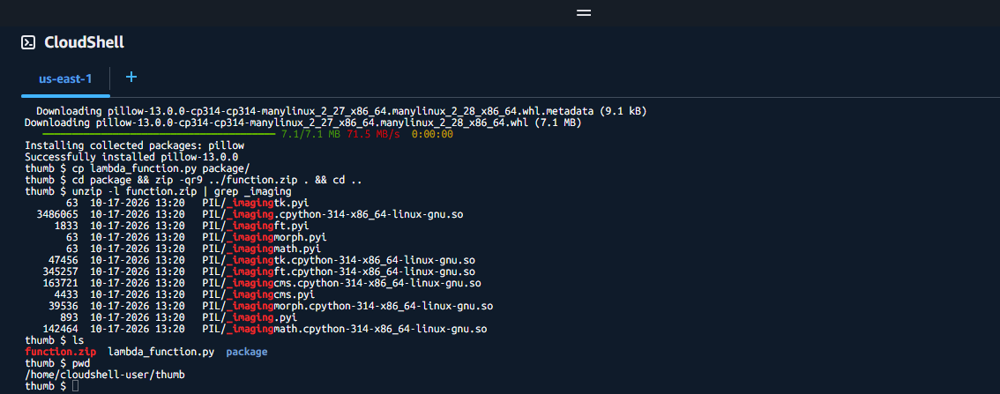
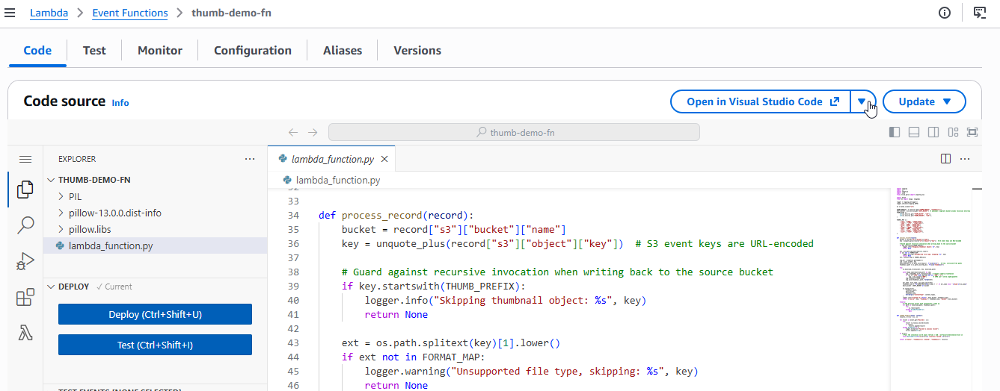
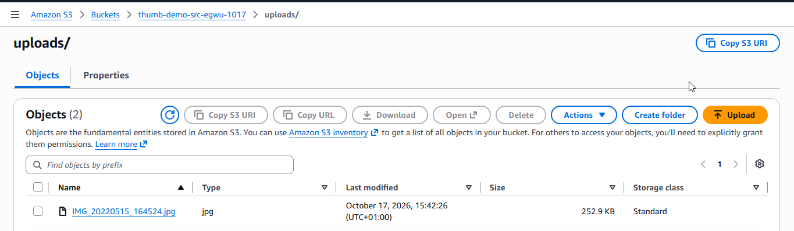
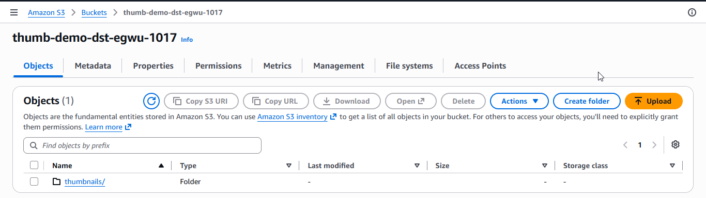
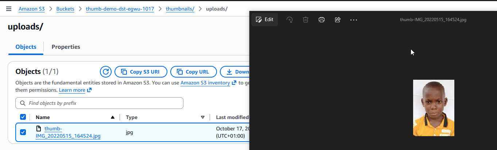

# Lambda + S3 Thumbnail Demo — AWS Console Guide

## Overview

By the end you will upload a photo to one S3 bucket and see a 128-pixel thumbnail of it appear in a second bucket a few seconds later, created automatically by a Lambda function.

&#91;embedded content: upload-to-thumbnail flow · 4 parts\]

S3 tells Lambda about each new upload; the function shrinks the image and writes it to a separate bucket.

- **Time:** about 45 minutes the first time.
- **Cost:** under $0.01 for the demo, if you complete the clean-up in Step 9.
- **You need:** an AWS account you can sign in to as an administrator (or a user allowed to use S3, Lambda, IAM, CloudShell and CloudWatch), the file `lambda_function.py` (in this project's `scripts/` folder), and one test image (a `.jpg` or `.png`).
- **Region:** pick one region, such as US East (N. Virginia), from the menu at the top right of the console, and stay in it for every step. Resources in different regions cannot see each other.

Write these down as you go; later steps ask for them:

| Item | Example | Yours |
| --- | --- | --- |
| Region | us-east-1 |  |
| Source bucket | thumb-demo-src-yourname-1017 |  |
| Destination bucket | thumb-demo-dst-yourname-1017 |  |
| IAM role | thumb-demo-role |  |
| Lambda function | thumb-demo-fn |  |

## Step 1: Create the two S3 buckets

You need two buckets: one for uploads and one for thumbnails. Keeping them separate stops the function from triggering itself in an endless, costly loop.

1. In the console search bar, type **S3** and open it.
2. Choose **Create bucket**.
3. **Bucket type:** General purpose.
4. **Bucket name:** your source bucket name, for example `thumb-demo-src-yourname-1017`. Names must be unique across all of AWS, lowercase, with no spaces.
5. Leave **Block all public access** ticked and every other setting at its default.
6. Choose **Create bucket**.
7. Repeat steps 2 to 6 for the destination bucket, for example `thumb-demo-dst-yourname-1017`.

**Check:** both bucket names appear in the S3 bucket list.

## Step 2: Create the IAM role for the function

The role is the function's permission slip: it may read from the source bucket, write to the destination bucket and write logs, and nothing else.

1. Open **IAM** from the search bar, then **Roles** in the left menu.
2. Choose **Create role**.
3. **Trusted entity type:** AWS service. **Use case:** Lambda. Choose **Next**.
4. In the permissions search box, type `AWSLambdaBasicExecutionRole`, tick it, and choose **Next**. This lets the function write logs.
5. **Role name:** `thumb-demo-role`. Choose **Create role**.
6. Open the new role from the list. On the **Permissions** tab, choose **Add permissions** → **Create inline policy**.
7. Switch the editor to **JSON**, delete what is there, and paste the policy below. Replace the two bucket names with yours.
8. Choose **Next**, name it `thumb-demo-s3-access`, and choose **Create policy**.

```json
{
  "Version": "2012-10-17",
  "Statement": [
    {
      "Effect": "Allow",
      "Action": "s3:GetObject",
      "Resource": "arn:aws:s3:::thumb-demo-src-yourname-1017/*"
    },
    {
      "Effect": "Allow",
      "Action": "s3:PutObject",
      "Resource": "arn:aws:s3:::thumb-demo-dst-yourname-1017/*"
    }
  ]
}
```

**Check:** the role's Permissions tab lists two policies, `AWSLambdaBasicExecutionRole` and `thumb-demo-s3-access`.

## Step 3: Build the deployment package in CloudShell

Lambda does not include Pillow, the image library, so you bundle it with your code into one zip file. CloudShell is a terminal inside the console, already signed in, so there is nothing to install on your computer.

1. Choose the **CloudShell** icon (a `>_` symbol) in the console's top bar and wait for the prompt.
2. Choose **Actions** → **Upload file** and upload `lambda_function.py`.
3. Paste these commands and press Enter:

```bash
mkdir -p ~/thumb && mv ~/lambda_function.py ~/thumb/ && cd ~/thumb
rm -rf package function.zip
python3 -m pip install pillow \
  --platform manylinux_2_28_x86_64 --platform manylinux2014_x86_64 \
  --implementation cp --python-version 3.14 \
  --only-binary=:all: --target package/
cp lambda_function.py package/
cd package && zip -qr9 ../function.zip . && cd ..
unzip -l function.zip | grep _imaging
```

4. The last line must print a file name containing `_imaging.cpython-314-x86_64-linux-gnu.so`. If it prints nothing, rerun the commands.
5. Choose **Actions** → **Download file**, enter `/home/cloudshell-user/thumb/function.zip`, and save it to your computer.

**Check:** you have `function.zip` on your computer, about 7 to 8 MB.

The end of a successful build: Pillow installs, and the `grep` lists `_imaging.cpython-314-x86_64-linux-gnu.so` among the files in the zip.



## Step 4: Create the Lambda function

1. Open **Lambda** from the search bar and choose **Create function**.
2. Choose **Author from scratch**.
3. **Function name:** `thumb-demo-fn`.
4. **Runtime:** Python 3.14.
5. **Architecture:** x86\_64. This must match the `x86_64` in the Step 3 commands.
6. Expand **Change default execution role**, choose **Use an existing role**, and pick `thumb-demo-role`.
7. Choose **Create function**.
8. On the **Code** tab, choose **Upload from** → **.zip file**, select `function.zip`, and choose **Save**.
9. Scroll to **Runtime settings** and confirm **Handler** reads `lambda_function.lambda_handler`. If not, choose **Edit** and correct it.

The console may say the package is too large for the code editor. That is normal with Pillow included; the function still works.

**Check:** the function page shows `thumb-demo-fn` with runtime Python 3.14.


After the upload, the **Code** tab shows `lambda_function.py` at the top level next to the `PIL`, `pillow-…dist-info` and `pillow.libs` folders. If your file is inside a subfolder instead, the handler can't find it.



## Step 5: Configure memory, timeout and environment variables

The defaults (128 MB, 3 seconds) are too small for image processing, and the function needs to know where to put thumbnails.

1. Open the **Configuration** tab, then **General configuration** → **Edit**.
2. Set **Memory** to `512` MB and **Timeout** to `0` min `30` sec. Choose **Save**.
3. Still on **Configuration**, choose **Environment variables** → **Edit** → **Add environment variable**, and add these two:

| Key | Value |
| --- | --- |
| DEST\_BUCKET | your destination bucket name |
| THUMB\_PREFIX | thumbnails/ |

4. Choose **Save**.

**Check:** General configuration shows 512 MB and 30 sec; Environment variables lists both keys.


## Step 6: Add the S3 trigger

The trigger tells S3 to run the function every time a file lands in the source bucket.

1. At the top of the function page, choose **Add trigger**.
2. **Source:** S3.
3. **Bucket:** your **source** bucket. Double-check it is not the destination bucket.
4. **Event types:** All object create events.
5. **Prefix:** `uploads/`. Only files in this folder will trigger the function.
6. Tick the box acknowledging the recursive invocation warning. This setup is safe because thumbnails go to a different bucket.
7. Choose **Add**.

**Check:** the function diagram at the top of the page shows an **S3** box on the left.


To confirm the details, open **Configuration** → **Triggers** and expand **Details**. The bucket should be your **source** bucket, the event type `s3:ObjectCreated:*`, and the prefix `uploads/`.


## Step 7: Upload an image and see the thumbnail

1. Open **S3** and choose your **source** bucket.
2. Choose **Create folder**, name it `uploads`, and choose **Create folder**.
3. Open the `uploads` folder and choose **Upload** → **Add files**. Pick your test image and choose **Upload**.
4. Wait about 10 seconds, then open your **destination** bucket.
5. Open `thumbnails/` → `uploads/`. You should see `thumb-<your file name>`.
6. Tick it and choose **Download** to view it. Its longest side is 128 pixels.

**Check:** the thumbnail exists and opens as a small version of your image.

The uploaded image in the source bucket's `uploads/` folder:



The destination bucket now has a `thumbnails/` folder, which the function created:



Inside `thumbnails/uploads/` is the thumbnail, here opened after downloading:



## Step 8: Read the function's logs

Logs show what the function did on each run, and are the first place to look when a thumbnail is missing.

1. On the function page, open the **Monitor** tab and choose **View CloudWatch logs**.
2. Open the newest entry under **Log streams**.
3. Look for a line beginning `Created s3://` followed by your destination bucket and thumbnail name.
4. The `REPORT` line shows the run's **Duration** and **Max Memory Used**, which together decide what you pay.

**Check:** you can see the `Created s3://` line and no `ERROR` lines.

A log stream for one run, with the `Created s3://…/thumbnails/uploads/thumb-…` line expanded:


The **Monitor** tab also lists recent invocations, with each run's duration and memory used:


## Troubleshooting

| What you see | Likely cause | Fix |
| --- | --- | --- |
| No thumbnail, and no new log stream | Image not in `uploads/`, or trigger on the wrong bucket | Upload into `uploads/` in the source bucket; check Step 6 |
| `cannot import name '_imaging' from 'PIL'` | Package built for the wrong Python version or architecture | Redo Step 3; confirm runtime Python 3.14 and x86\_64 |
| `Unable to import module 'lambda_function'` | Files are inside a folder in the zip, or the handler is wrong | Rebuild with Step 3's commands; set handler to `lambda_function.lambda_handler` |
| `AccessDenied` in logs | Bucket names in the inline policy don't match | Edit the Step 2 policy with the exact names |
| `Task timed out after 3.00 seconds` | Step 5 settings not saved | Set the timeout to 30 sec and memory to 512 MB |
| `Unsupported file type, skipping` | The file isn't an image the function handles | Use jpg, jpeg, png, gif, webp, bmp, tif or tiff |
| `NoSuchBucket` | `DEST_BUCKET` is misspelled | Correct the environment variable in Step 5 |

## Step 9: Clean up

Delete everything when you finish so nothing keeps billing. Work in this order, because a bucket must be empty before it can be deleted.

- [ ] **Lambda:** open `thumb-demo-fn`, choose **Actions** → **Delete**, type `confirm`, and choose **Delete**.
- [ ] **S3, both buckets:** select the bucket, choose **Empty**, type `permanently delete`, and confirm. Then select it again, choose **Delete**, type the bucket name, and confirm.
- [ ] **IAM:** open **Roles**, select `thumb-demo-role`, choose **Delete**, type the role name, and confirm.
- [ ] **CloudWatch:** open **Log groups**, select `/aws/lambda/thumb-demo-fn`, and choose **Actions** → **Delete log group(s)**.
- [ ] **CloudShell (optional):** run `rm -rf ~/thumb` to free its storage.
