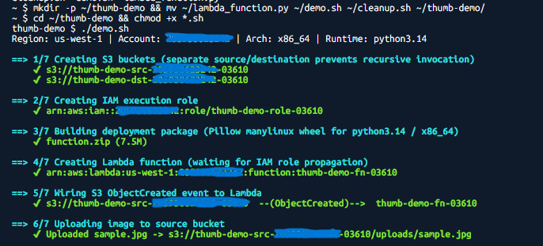
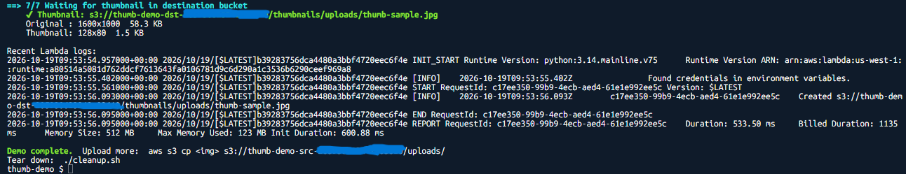
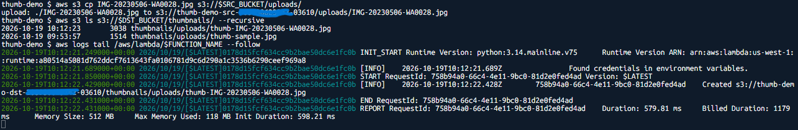
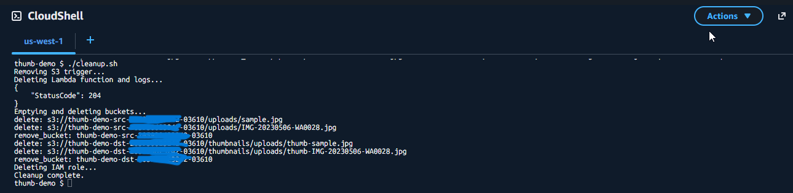

# Demo: AWS Lambda + Amazon S3 — Thumbnail on Upload

Upload an image to S3 → S3 `ObjectCreated` event invokes Lambda → Lambda resizes it with Pillow → thumbnail lands in a second bucket.

```
 [ you ] --aws s3 cp--> [ S3 source bucket ] --ObjectCreated--> [ Lambda (python3.14 + Pillow) ]
                                                                          |
                                         [ S3 destination bucket ] <------+  thumbnails/uploads/thumb-<name>
```

## Project layout

```
Lambda_S3_Demo/
├── README.md                                        # this file: scripted demo
├── Lambda + S3 Thumbnail Demo — AWS Console Guide.md  # the same demo, done by hand in the console
├── scripts/
│   ├── lambda_function.py   # Handler: decodes keys, fixes orientation/mode, resizes to 128×128 max, uploads with ContentType
│   ├── demo.sh              # Creates buckets, IAM role, package, function, trigger; uploads an image and verifies the thumbnail
│   └── cleanup.sh           # Deletes everything the most recent demo.sh run created (names read from .demo-env)
├── screenshots-auto/        # CloudShell output of demo.sh / cleanup.sh (used in this README)
└── screenshots/             # AWS console screenshots (used in the Console Guide)
```

`demo.sh` and `cleanup.sh` always work from the `scripts/` folder, whatever directory you run them from. The build files (`package/`, `function.zip`, `sample.jpg`, `thumb-*`) and `.demo-env` are written there.

## Run (AWS CloudShell)

1. Open CloudShell in your target region.
2. **Actions → Upload file** → upload the three files from `scripts/`.
3. Run:

```bash
mkdir -p ~/thumb-demo/scripts && mv ~/lambda_function.py ~/demo.sh ~/cleanup.sh ~/thumb-demo/scripts/
cd ~/thumb-demo && chmod +x scripts/*.sh
./scripts/demo.sh                 # generates a 1600x1000 sample image
# or
./scripts/demo.sh my-photo.jpg    # upload your own (upload it to CloudShell first)
```

Runs in ~1–2 minutes. Options: `ARCH=arm64 ./scripts/demo.sh`, `AWS_REGION=eu-west-1 ./scripts/demo.sh`.

## Run locally (Linux, macOS, or Git Bash on Windows)

The same script works from your own machine and produces the same resources.

**Requirements**

- AWS CLI v2, signed in (`aws sts get-caller-identity` should print your account)
- Python 3 with pip, available as `python3` or `python` (the script uses whichever it finds)
- `zip` is optional. If it's missing (as in Git Bash), the script uses Python's built-in `zipfile`.
- A virtualenv is fine. The script adds `pip install --user` only when no virtualenv is active.

```bash
cd path/to/Lambda_S3_Demo
./scripts/demo.sh                          # uses your default region (aws configure get region)
AWS_REGION=us-west-1 ./scripts/demo.sh     # or pick the region explicitly
```

Notes:

- **Region:** the script uses `AWS_REGION` if it's set, otherwise your AWS CLI default region. Your local default can differ from the region your CloudShell tab uses, so check the console in the right region.
- **Windows:** run the scripts from **Git Bash**, not PowerShell or cmd. The AWS CLI on Windows prints `\r\n` line endings, and the script strips the `\r` so it can't end up in bucket names or ARNs.
- **Cross-platform package:** pip downloads the Linux (`manylinux`) Pillow wheel for Lambda no matter which OS you build on, so a package built on Windows or macOS works.
- Run `cleanup.sh` on the same machine as `demo.sh`, because it reads `scripts/.demo-env`, which `demo.sh` writes there.

## What the audience sees

| Step | Shows |
|---|---|
| 1 | Two private buckets (separate src/dst = no recursive invocation) |
| 2 | Least-privilege role: `GetObject` on src, `PutObject` on dst, CloudWatch Logs |
| 3 | Deployment package with Pillow manylinux wheel for Python 3.14 (binary verified) |
| 4 | Lambda function: 512 MB, 30 s, env vars `DEST_BUCKET`, `THUMB_PREFIX` |
| 5 | Resource policy allowing S3 to invoke + bucket notification |
| 6 | Image upload to `uploads/` |
| 7 | Thumbnail appears; original vs thumbnail dimensions/size printed; Lambda logs tailed |

### Example: a successful run in CloudShell

Steps 1–6 create the buckets, IAM role, deployment package (7.5 MB), Lambda function, and S3 trigger, then upload the sample image:



In step 7, the 1600×1000 sample is resized to a 128×80 thumbnail, and the Lambda logs show the invocation:



## Live follow-ups during the demo

```bash
source scripts/.demo-env
aws s3 cp another.png s3://$SRC_BUCKET/uploads/                    # trigger again
aws s3 ls s3://$DST_BUCKET/thumbnails/ --recursive                 # list thumbnails
aws logs tail /aws/lambda/$FUNCTION_NAME --follow --region $REGION # watch invocations
```

Uploading your own photo triggers the function again, and its thumbnail appears next to the sample's:



Console view: **Lambda → function → Monitor** (invocations, duration) and **S3 → destination bucket → thumbnails/**.

## Cleanup

```bash
./scripts/cleanup.sh
```



`.demo-env` only records the latest run. If `demo.sh` failed or ran more than once, earlier runs can leave resources behind. To find them:

```bash
aws s3 ls | grep thumb-demo
aws iam list-roles --query "Roles[?starts_with(RoleName,'thumb-demo-role')].RoleName" --output text
aws lambda list-functions --query "Functions[?starts_with(FunctionName,'thumb-demo-fn')].FunctionName" --output text --region <region>
```

To remove them:

```bash
aws s3 rb s3://<bucket> --force
aws iam delete-role-policy --role-name <role> --policy-name thumb-demo-policy
aws iam delete-role --role-name <role>
aws lambda delete-function --function-name <function> --region <region>
```

## Troubleshooting

| Symptom | Fix |
|---|---|
| `cannot import name '_imaging' from 'PIL'` | Package built for wrong OS/Python/arch — rebuild via `demo.sh` (it checks for `_imaging.cpython-314`) |
| Thumbnail never appears | `aws logs tail /aws/lambda/$FUNCTION_NAME` — usually IAM or unsupported file extension |
| `Unsupported file type` in logs | Supported: jpg, jpeg, png, gif, webp, bmp, tif, tiff |
| `BucketAlreadyExists` | Re-run; names include account ID + timestamp suffix |
| `Can not perform a '--user' install. User site-packages are not visible in this virtualenv.` | Fixed in the current `demo.sh`, which skips `--user` inside a virtualenv. Update the script. |
| `Pillow binary missing`, then buckets and role exist but no Lambda function | Older `demo.sh` checked with `unzip -l \| grep -q`, which falsely fails under `set -o pipefail`. Update the script, run `./scripts/cleanup.sh`, and re-run. |
| `python3: command not found` / `zip: command not found` (Windows) | Use the current `demo.sh`: it falls back to `python` and to Python's `zipfile`. |
| Names or ARNs look broken, or `Invalid bucket name` on Windows | Run from Git Bash with the current `demo.sh`, which strips the `\r` that the Windows AWS CLI adds. |